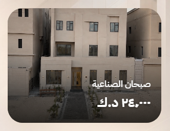
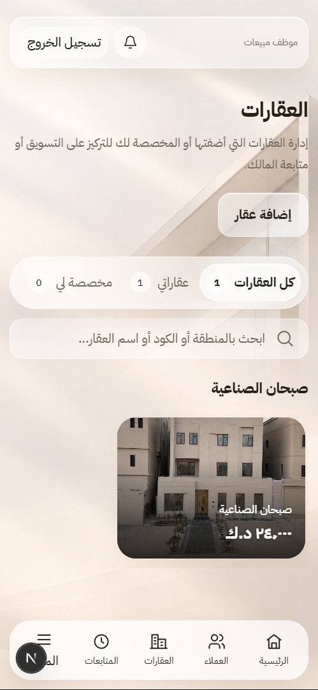

# تصحيح كروت عقارات الموظف — صورة كاملة

- **التاريخ:** 2026-10-16
- **النطاق:** عرض كرت عقار الموظف فقط، مع إبقاء درج التفاصيل الحالي.
- **الحالة:** `Completed` — لا commit أو push.

## المشكلة والسبب

كان `EmployeePropertyCard` يستخدم تنسيقات كرت المدير المشتركة، بارتفاع أدنى 315px ومحتوى نصي داخل التدفق. وكان يعرض حالة العقار ونوع العملية والعنوان والكود والمساحة وملاحظات الأدوار ورابط التفاصيل؛ وهذا لا يطابق التصميم المعتمد للكرت المصوّر المختصر، ويسمح للمحتوى الطويل بزيادة ارتفاعه.

## التغيير المحدد

- صورة العقار الرئيسية تغطي كامل الكرت، من الحافة إلى الحافة، باستخدام `object-fit: cover` ودون حشو حول الصورة.
- نسبة أبعاد ثابتة **4:3**، وزوايا مستديرة من هوية Astra الحالية.
- النصان المرئيان الوحيدان: **المنطقة** و**السعر بالدينار الكويتي**، مباشرة فوق الصورة. لا قسم نصي أسفلها، ولا شارات أو وصف أو ملاحظات أو أكواد أو زر تفاصيل.
- تدرج داكن هادئ أسفل الصورة ونص أبيض للوضوح، مع دعم RTL وحالتي المرور والتركيز بلوحة المفاتيح.
- سطر واحد لكل نص مع اقتطاع `ellipsis`؛ لا يغيّر النص الطويل ارتفاع الكرت.
- السعر الفارغ أو غير الصالح: «السعر غير محدد». يدعم تنسيق السعر حتى ثلاث منازل عشرية دون فرض أصفار إضافية.
- عند غياب الصورة أو تعذر تحميلها: خلفية محايدة وأيقونة منزل فقط، دون إضافة نص ثالث أو استخدام صورة عقار مضللة.
- الكرت كله زر أصلي قابل للضغط، مع إبقاء `onOpen` الحالي، والتحميل المؤجل للصورة عبر `usePropertyImage` المؤمّن كما هو.
- بقي تصدير `PropertyStatusBadge` مستخدمًا داخل درج التفاصيل؛ أُزيلت الشارة من الكرت فقط.

## الملفات

| الملف | التغيير |
| --- | --- |
| `apps/frontend/features/employee-properties/components/employee-property-card.tsx` | اختصار العرض للصورة والمنطقة والسعر، ومعالجة فشل الصورة |
| `apps/frontend/features/employee-properties/components/properties.module.css` | أصناف محلية للكرت المصوّر، دون تعديل CSS كروت المدير أو الدرج |
| `docs/reports/2026-10-16-full-image-property-card-fix.md` | هذا التقرير |
| `docs/reports/README.md` | إضافة رابط التقرير |
| `docs/reports/assets/2026-10-16-full-image-card-{desktop,mobile}.png` | لقطتا التحقق البصري |

راجعت حالة Git والفرق قبل التعديل. توجد أعمال سابقة كثيرة غير ملتزمة، منها تكاملات الخلفية والواجهة والمعالج. حُفظت دون reset أو revert. **لم تُعدّل هذه المهمة المعالج ثلاثي الخطوات، أو درج التفاصيل، أو خصوصية البيانات، أو DTO، أو قاعدة البيانات، أو الموافقة والرفض.**

## التحقق البصري والتفاعلي

تم التحقق على الواجهة الفعلية `http://localhost:3001/employee/properties` بحساب الموظف، باستخدام العقار الموجود دون إنشاء أو تعديل عقارات.

| الاختبار | النتيجة |
| --- | --- |
| سطح المكتب، نافذة CSS بحجم 1313×953 | الصورة كاملة والنصان فوقها فقط؛ أبعاد الكرت نحو 234×175px ونسبة 4:3 |
| قياس الصورة مقارنة بالكرت | العرض والارتفاع متطابقان، و`object-fit: cover` |
| الضغط على الكرت | يفتح درج التفاصيل الموجود؛ فحص مواضع أعلى وأسفل الكرت يؤكد أنها ضمن الزر نفسه |
| محتوى الدرج | الصورة وحالة الموافقة وملاحظات الأدوار والوصف وبيانات المالك المصرّح بها ما زالت موجودة |
| الهاتف 390×844 | فحص الصفحة الحقيقية داخل iframe بنفس الأصل؛ لا تجاوز أفقي، والكرت نحو 230×172px |
| لوحة المفاتيح | تركيز الزر واستخدام Enter؛ تحقق فتح درج التفاصيل في عرض الهاتف |
| نص منطقة وسعر طويلان | اختبار DOM مؤقت: الارتفاع ثابت، والاقتطاع يعمل، ولا تجاوز أفقي؛ أُعيد النص الأصلي |
| تعذر فك الصورة | محاكاة حدث `error` في إطار الاختبار؛ اختفت الصورة المكسورة وظهرت الأيقونة، مع بقاء النصين والارتفاع |

### لقطات بعد التصحيح

سطح المكتب — قصّ للكرت من لقطة المتصفح:

عرض الهاتف — صفحة التطبيق الحقيقية ضمن نافذة إطار 390×844:

## اختبارات عدم التراجع

شُغلت **7 حالات مركزة** عبر Node وTypeScript وReact server rendering، مع محاكاة hook الصورة دون طلبات API: سعر صحيح، سعر فارغ، سعر غير رقمي، سعر سالب، سعر بثلاث منازل عشرية، صورة متاحة، وبقاء شارة الحالة اللازمة للدرج. تحققت الحالات أيضًا من بقاء الزر ومرجع `onOpen` وعدم تسرب العنوان والكود والحالة والنوع والوصف وملاحظات الأدوار إلى الكرت.

**النتيجة:** `7 passed`. كان تشغيل الفحص الأول متأثرًا بترميز النص العربي في PowerShell؛ أُعيد بترميز UTF-8 ونجح. لم يتطلب ذلك تغييرًا وظيفيًا في الكود.

| أمر التحقق المطلوب | النتيجة |
| --- | --- |
| `npm run typecheck -w @arkan/frontend` | نجاح — exit 0 |
| `npm run lint` | نجاح — exit 0 |
| `npm run build -w @arkan/frontend` | نجاح — توليد 22 مسارًا |
| `git diff --check` | نجاح — exit 0؛ تحذيرات LF/CRLF فقط، لا أخطاء whitespace |

## القيود

- تحقق الهاتف **responsive viewport داخل iframe**، وليس جهازًا فعليًا أو اختبار Safari/لوحة مفاتيح هاتف.
- البيانات الحالية أتاحت التحقق من عقار موظف وجهة اتصال مالك؛ لم تُنفذ مصفوفة حسابات موظفين/وسطاء أو اختبارات موافقة ورفض. مساراتها وقواعد الخصوصية لم تتغير.
- حالات السعر الفارغ والصورة الغائبة فُحصت بمحاكاة مركزة؛ لم تُكتب بيانات اختبار في قاعدة التطبيق، ولم تُحذف مسودات المتصفح.
- لم يُشغّل اختبار شامل للخلفية؛ نطاق التغيير واجهة الكرت فقط.

**التوقف:** التصحيح موثّق وجاهز للمراجعة، دون commit أو push.
